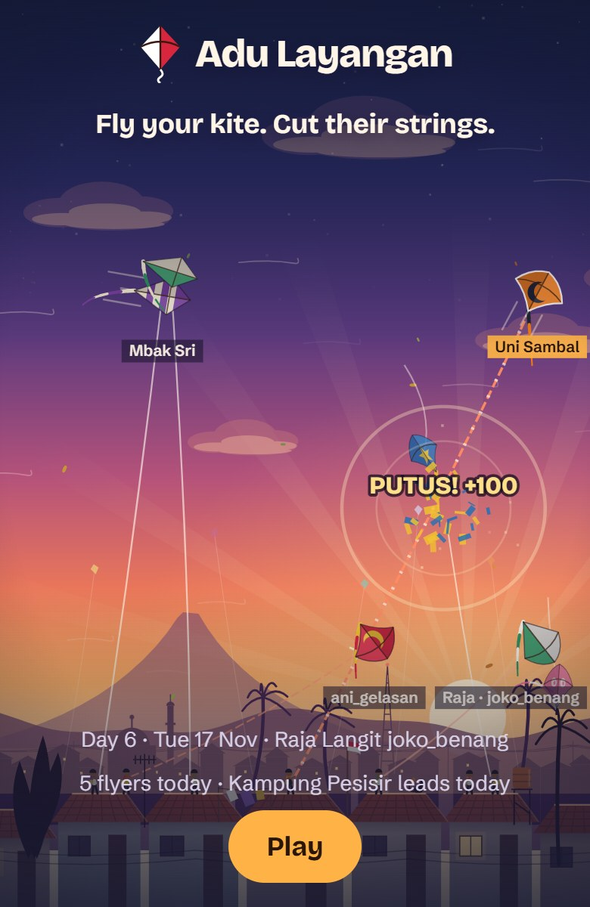
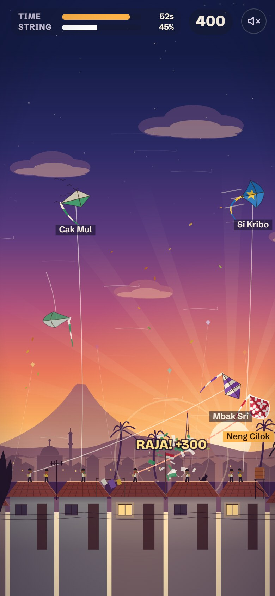
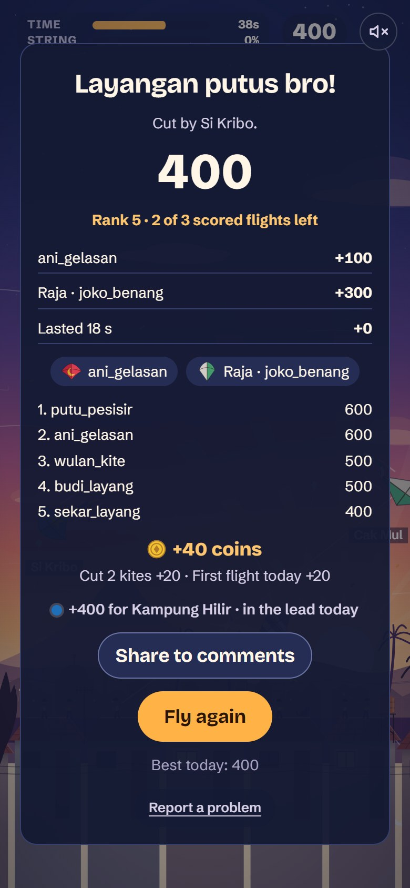
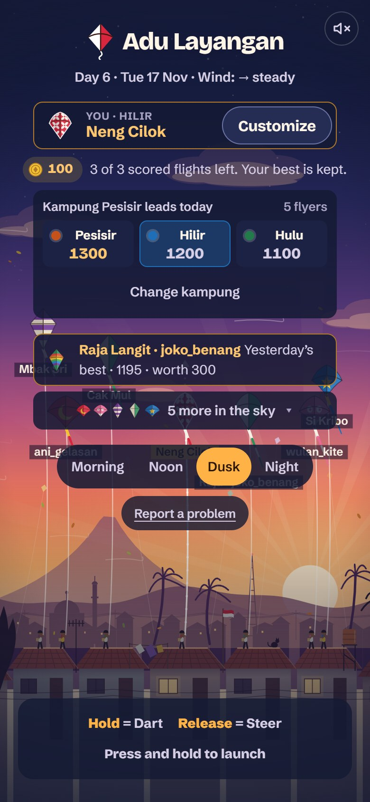
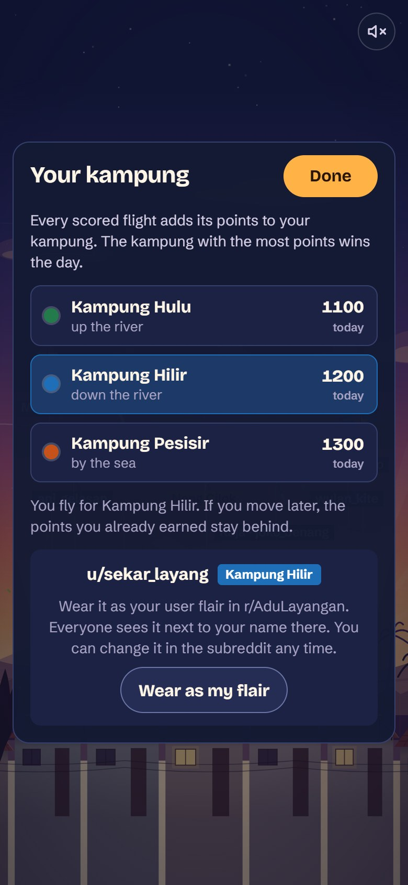
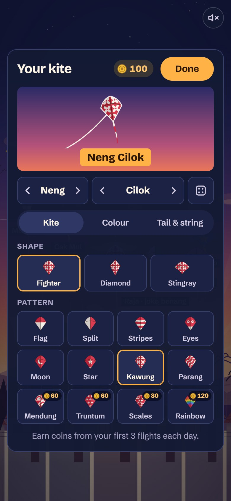
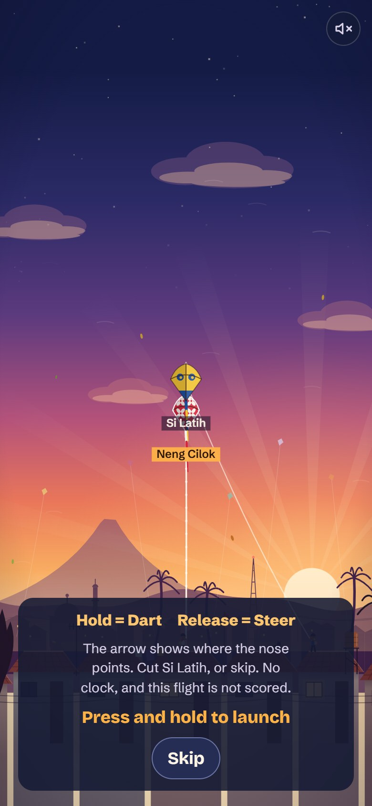

# Adu Layangan

**A daily kite fight over an Indonesian kampung, played on Reddit.**

Fly a fighter kite with one finger. Cross a rival's string and saw through it with yours. One sky a day, the same for everyone, and yesterday's best flyer comes back as the boss.

<p align="center">
  
  &nbsp;
  
  &nbsp;
  
</p>
<p align="center"><sub>The post in the feed · Cutting down Raja Langit · The result card</sub></p>

## In one minute

Every day at 00:00 UTC the subreddit gets a new sky: a new wind, three rival flyers from the kampung, and **Raja Langit**, the best flight from the day before, played back as it was flown. A round lasts 60 seconds. You hold to pull your string and let go to steer, and where your string crosses a rival's, the faster one saws through the slower. Your best of three scored flights is kept.

Every flight counts for a side. Players fly for one of three kampungs, and the kampung with the most points wins the day. You can wear your kampung as your flair, post your score card in the day's thread, and tomorrow your own flight may be the king everyone else is trying to cut down.

It is for anyone who wants a one-minute game a day, and for communities that want a daily ritual to play together. For moderators, the app runs itself: it posts the day's sky on its own and keeps nothing about a player for more than 30 days.

_Adu layangan_ is Indonesian for "kite fighting", played from the rooftops every dry season with glass-coated string.

## A day in Adu Layangan

1. **The post goes up.** Its title names today's Raja Langit and the kampung that won yesterday: _Adu Layangan · Day 7 · Cut down joko_benang · Kampung Hulu won yesterday_.
2. **The feed card plays the day's sky by itself**, so you see the fight before you tap **Play**.
3. **You fly up to three scored flights.** The best one is kept on today's standings; after three, you can practise as much as you like.
4. **Your points go to your kampung.** The ready screen shows who leads; the result card shows what your flight added.
5. **You share your flight** as a comment under the day's pinned thread, if you want to.
6. **Tomorrow, the best flight flies again** as Raja Langit, worth 300 points to whoever cuts it, and the next two best fly beside it.

## How to play

|                    |                                                                                                                                                      |
| ------------------ | ---------------------------------------------------------------------------------------------------------------------------------------------------- |
| **Hold** anywhere  | Pull the string: the kite darts where its nose points.                                                                                               |
| **Let go**         | The string goes slack: the kite spins slowly and drifts with the wind.                                                                               |
| **Cross a string** | Where two strings rub, the one moving faster at the crossing saws through the slower one. Pull while you cross theirs, and pull when they rub yours. |

That is how a real fighter kite is steered: let it spin until the nose points where you want, then pull. An arrow on your kite shows where the nose points.

- A frayed string never mends. The **String** bar shows how much of yours is left; **Time** shows how much of the round is left.
- A dive is faster than a climb. Dive into the roofs and your kite glances off them, frayed; let go near the roofs and the warm air lifts you back up.
- The wind is weak just above the roofs and strongest high up. The wisps in the sky and the flag show which way it blows.
- If your kite goes down while others are still flying, you can stay and watch them fight it out, or go straight to your result.

The first time you play, one practice kite crosses the middle with no clock and no score, so the controls are learned by flying, not by reading.

## Scoring

|                                                  | Points                      |
| ------------------------------------------------ | --------------------------- |
| Cutting a rival's string                         | 100                         |
| Cutting **Raja Langit**, yesterday's best flight | 300                         |
| Lasting the whole round                          | 150                         |
| Clearing the sky early                           | 150, plus 5 per second left |

Your string is glass-coated (_benang gelasan_): it takes about twice as much rubbing to cut as a rival's, and wears theirs down faster than theirs wears yours.

## Played together

<p align="center">
  
  &nbsp;
  
</p>

- **Three kampungs.** Pick **Hulu** (up the river), **Hilir** (down the river) or **Pesisir** (by the sea). Every scored flight adds its points to your kampung for the day, the kampung with the most points wins it, and the next day's post says who won. You can move to another kampung at any time; points already earned stay where they were earned.
- **Kampung flair.** Wear your kampung as your user flair, so it shows next to your name in the comments. The game shows you exactly how it will look and sets it only when you tap **Wear as my flair**.
- **Raja Langit and recorded flights.** Every scored flight is recorded. Yesterday's best comes back as today's boss, and the next two fly beside it, so the rivals in the sky are other players of the subreddit. A flight you make today can be someone's rival tomorrow. On a day with no recordings yet, the kampung's own flyers take those places.
- **The day's thread.** The result card can post your flight as a short score card, as your own comment, in reply to the day's pinned thread. You see the exact text and the account it will be posted from before anything is posted, and each flight is posted at most once.
- **Today's standings** appear on every result card, so you know where you stand after each flight.

## Your kite

<p align="center">
  
  &nbsp;
  
</p>

Tap **Customize** before a round to make the kite yours: its shape, its pattern (including the batik motifs _kawung_ and _parang_), its two colours, its tail and string, and the name you fly under, put together from a kampung title and a nickname, like _Bang Petir_ or _Neng Cilok_. Names are picked from lists, never typed. Your colours fly in everyone else's sky when they meet your recorded flight.

**Coins** come from your first three flights each day: 10 for every kite you cut, 15 for lasting the round, 25 for clearing the sky, 20 for your first flight of the day, and a little more for every day in a row you play. You start with 100. Coins buy looks only (batik and rainbow patterns, twin, tasselled and lantern tails, gold, neon and rainbow strings), never speed or strength, and they cannot be bought.

Before a round you can also pick the time of day the sky is drawn in: morning, noon, dusk or night. It changes the look, not the wind, the rivals or the scoring.

## Fair play and privacy

- **Everyone flies the same sky.** The day's wind and rivals come from the date, so every player meets the same fight.
- **Scores cannot be faked.** The game sends only the moments you pressed and let go. The server replays the round on the same sky and counts the score and coins itself.
- **No pay to win.** Coins buy looks only.
- **Little is kept, and not for long.** Your kite and name, your kampung, your coins and the looks you bought, your best score of each day and the recording of that flight. Everything about a player is deleted 30 days after it last changed.
- **Nothing leaves Reddit.** The app makes no requests outside Reddit, and comments and flair are only ever made from your own tap.

## Built for phones

The game is drawn for a phone held upright and played with one thumb; a mouse or the Space bar work too. Strings, kites and the kampung are drawn by hand on a canvas, with a sound for the wind, the rubbing strings and the snap. The feed card plays at 30 frames a second and stops drawing while it is scrolled out of view, so it does not drain a phone in the feed. Motion is reduced for players who ask their phone for less.

## For moderators

- Installing the app creates the day's post, and a new one goes up every day at 00:00 UTC. To create it by hand, open the subreddit menu and choose **Post today's sky**.
- For kampung flair to show next to names, turn on user flair in the subreddit's settings. The app sets each player's flair only when that player asks for it.
- **Report a problem**, on the ready screen and the result card, opens a message to the subreddit's moderators with the day already filled in.

## Reporting a problem

Tap **Report a problem** on the ready screen or the result card. It opens a message to the moderators of the subreddit where you play.

## For developers

Requires Node 22.12 or newer.

```bash
npm install
npm test              # 68 tests: flight, cutting, replay, scoring, coins, kampungs, sharing
npm run dev:local     # the whole game in a browser at http://localhost:5180/game.html, without Reddit
npm run dev           # playtest on Reddit (needs `npm run login` first)
npm run build         # the bundle Reddit runs
```

```
src/shared/sim/   the kite fight: flight, wind, strings, rivals, recorded flights, the daily sky
                  (the same code runs in the browser and on the server)
src/shared/       kites and names, coins, kampungs, the score card
src/client/       the web view: feed card (splash) and game; arena/ draws the sky, the kampung and the kites
src/server/       endpoints that run on Reddit's servers: rounds, coins, kampungs, flair, the daily post
```

- **Deterministic simulation.** Angles are whole numbers and the sine table is the game's own instead of `Math.sin`, so the same taps produce the same round on every device. The server scores each round by replaying the player's taps, and recorded flights are replayed the same way.
- **What you see is what is scored.** The string the simulation tests for a touch is the same curve that is drawn (`src/shared/sim/line.ts`), so sparks always sit on the strings you see.
- **The local preview is the real server.** `npm run dev:local` runs the same routes with an in-memory store and stand-ins for Reddit's user, comments and flair.
- **Devvit Journeys** record when a flight starts and ends and when a card is shared.

## Credits

- Game, art and code: u/bagusardin_, for Reddit's Game of the Day Hackathon, 2026.
- Type: Bricolage Grotesque and Schibsted Grotesk, both under the SIL Open Font License 1.1 (notices in LICENSE).
- Built on Devvit Web, React and Hono.

## License

Copyright © 2026 bagusardin25. All rights reserved. The code and art are published to be read and reviewed, not reused; see [LICENSE](LICENSE). The fonts and open-source packages keep their own licences.
